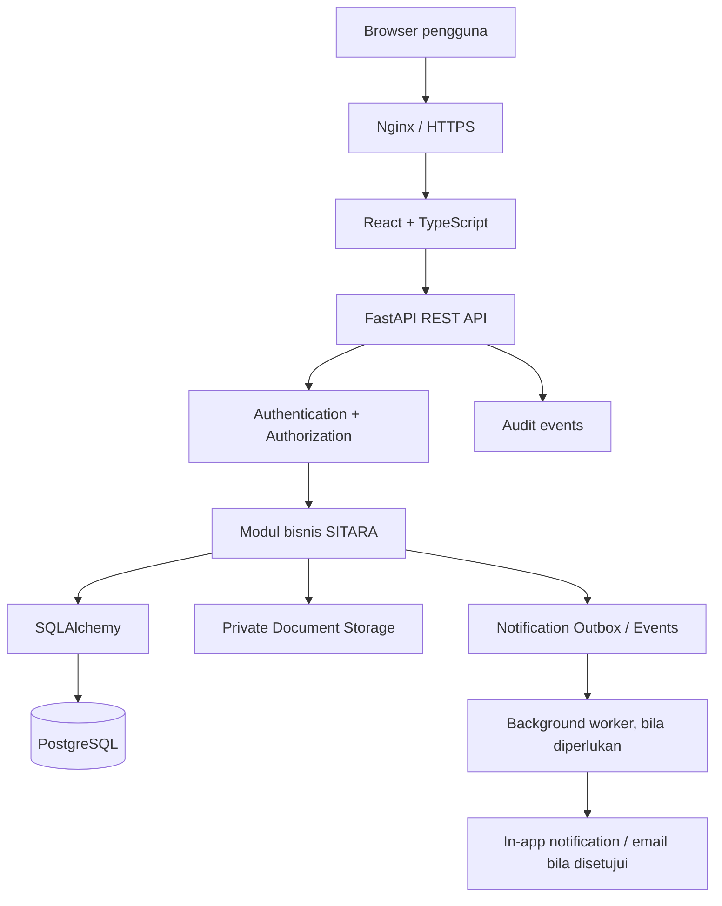

# SITARA — Architecture

**Versi:** 1.0-draft · **Tanggal:** 14 Oktober 2026  
**Gaya arsitektur:** modular monolith, API-first, role- and object-aware authorization.

## 1. Tujuan dan prinsip

Dokumen ini menjelaskan stack, batas modul, aliran request, keamanan, rancangan data, pengujian, dan deployment SITARA. Desain ditujukan agar dapat dikembangkan satu developer dengan bantuan AI agent tanpa membangun infrastruktur yang terlalu kompleks.

Prinsip:

- Modular monolith dahulu; tidak memecah layanan sebelum ada kebutuhan yang terbukti.
- PostgreSQL sebagai sumber data utama yang konsisten.
- Server-side authorization setiap request dan setiap akses objek/dokumen.
- Database schema changes hanya melalui migrasi Alembic.
- Private document storage dipisah dari direktori web publik.
- TDD, test negatif, scanner, dan code review menjadi quality gate.
- Draf AI/OCR tidak dapat menggantikan keputusan atau pengesahan manusia.

## 2. Stack teknologi

| Lapisan | Teknologi | Status/kegunaan |
|---|---|---|
| Frontend | React + TypeScript + Vite | Sudah menjadi baseline proyek. |
| Styling | CSS token/global CSS pada starter; Tailwind CSS dapat diadopsi setelah integrasi terencana | Jangan mencampur dua pendekatan styling secara acak. Jika mengadopsi Tailwind, dokumentasikan perubahan dependency dan standar komponen. |
| Komponen UI | Komponen internal sederhana; shadcn/ui sebagai opsi yang perlu ditambahkan secara eksplisit | Belum terpasang pada starter saat dokumen ini ditulis. |
| API/backend | FastAPI + Pydantic Settings | Baseline backend. |
| ORM | SQLAlchemy 2.x | Akses dan transaksi database. |
| Migrasi | Alembic | Riwayat skema yang terversi. |
| Database | PostgreSQL | Data relasional utama. |
| Test backend | pytest, pytest-cov, HTTPX TestClient | Unit/API/integration testing. |
| Quality backend | Ruff, mypy | Lint, format, dan type checking. |
| Test frontend | Vitest, React Testing Library | Unit/component test. |
| Quality frontend | ESLint, Prettier, TypeScript | Lint, format, build/type check. |
| Secret scanning | Gitleaks | Pre-commit dan CI; instalasi lokal perlu diverifikasi developer. |
| Security analysis | Semgrep, `npm audit`, `pip-audit` | Static analysis dan audit dependency. |
| CI | GitHub Actions | Quality/security gates. |
| Database lokal | Docker Compose PostgreSQL | Development/testing; bukan database production. |
| Production edge | Nginx + TLS pada Cloud VPS | Reverse proxy, terminasi HTTPS, dan routing frontend/API. |

Versi dependency dikunci dengan lockfile yang sesuai. Backend perlu menghasilkan lock/constraints yang dapat direproduksi sebelum deployment produksi; frontend harus meng-commit `package-lock.json` dan menggunakan `npm ci` di CI setelah lockfile tersedia.

## 3. Diagram container dan request



Pada MVP, satu deployment backend modular cukup. Background worker terpisah dapat ditambahkan ketika OCR, pengiriman notifikasi, atau jadwal pengingat memerlukan proses asynchronous yang andal. Jangan mengirim email atau melakukan OCR berat di jalur request jika hal itu membuat request menggantung.

## 4. Batas modul backend

Usulan struktur bertahap di dalam `backend/app/`:

```text
app/
  main.py
  api/
    routes/
      health.py
      auth.py
      meetings.py
      agendas.py
      decisions.py
      action_items.py
      documents.py
      notifications.py
      reports.py
  core/
    config.py
    security.py
    permissions.py
    logging.py
  db/
    session.py
    base.py
  models/
    user.py
    role.py
    organization.py
    meeting.py
    decision.py
    task.py
    document.py
    audit.py
  schemas/
  repositories/
  services/
  policies/
  tests/
```

Ini adalah target perkembangan, bukan perintah untuk membuat semua file kosong saat ini. Tambahkan modul ketika fitur terkait dikerjakan. Layer yang disarankan:

- **API/router:** HTTP, dependency, status response, validasi boundary; jangan memuat alur bisnis besar.
- **Schema:** Pydantic input/output; jangan mengembalikan model ORM mentah ke publik.
- **Service/use case:** aturan bisnis dan transaksi lintas objek.
- **Repository/data access:** query kompleks yang perlu dipisahkan atau digunakan ulang; hindari repository wrapper tanpa nilai tambah.
- **Model:** constraint relasi dan representasi domain database.
- **Policy/authorization:** keputusan izin terpusat dan dapat diuji.

Gunakan design pattern hanya bila menyelesaikan kebutuhan nyata, misalnya policy object untuk beberapa aturan akses, adapter untuk penyimpanan dokumen, atau service untuk transaksi lintas tabel. Jangan menambah abstraction hanya untuk terlihat enterprise.

## 5. Batas modul frontend

Target perkembangan:

```text
frontend/src/
  app/                 # router, provider, app shell
  components/          # komponen generik dan aksesibel
  features/
    auth/
    dashboard/
    meetings/
    minutes/
    decisions/
    action-items/
    approvals/
    documents/
    notifications/
    reports/
  lib/                 # API client, format, helpers
  styles/              # design tokens/global styles
  test/                # test setup dan helpers
```

Folder `features` membatasi komponen/domain agar modul tidak saling mengimpor implementasi internal sembarangan. Jangan pindahkan semua kode starter sekaligus tanpa fitur yang membutuhkannya; struktur bertambah secara inkremental.

## 6. Gambaran model data

Entitas inti:

- Organisasi/akses: `users`, `roles`, `permissions`, `user_roles`, `role_permissions`, `units`, `user_units`, `reporting_lines`, `user_sessions`.
- Rapat: `meetings`, `meeting_participants`, `agendas`, `discussions`, `decisions`, `decision_briefs`, `document_versions`.
- Tindak lanjut: `action_items`, `assignments`, `progress_updates`, `approvals`, `status_histories`, `task_notes`.
- Dokumen dan aktivitas: `documents`, `notifications`, `audit_logs`, `document_templates`.

Relasi konseptual:

```text
Meeting 1 ── N Agenda 1 ── N Discussion 1 ── N Decision
Decision 1 ── 0..N Action Item 1 ── N Assignment
Assignment 1 ── N Progress Update
Action Item 1 ── N Approval / Status History / Task Note
Meeting/Action Item/Progress Update ── Documents sesuai jenis dan hak akses
User ── Roles / Units / Reporting Lines / Notifications / Audit Events
```

**Penting: koreksi sebelum menjadikan SQL draft sebagai migrasi produksi.** File `docs/sitara_schema_v1_draft.sql` saat ini mendefinisikan `action_items.decision_id` sebagai `UNIQUE`, yang berarti satu putusan hanya dapat menghasilkan satu action item. Kebutuhan produk adalah satu putusan dapat menghasilkan beberapa action item dengan progres terpisah. Karena itu, kolom tersebut harus menjadi foreign key non-unique dan relasi/constraint terkait harus diperbarui sebelum membuat model SQLAlchemy/Alembic final. Jangan menjalankan draft SQL itu langsung di production.

Untuk `is_action_item`, validasi konsistensinya dalam service/transaksi dan tambahkan constraint trigger bila desain database final memerlukannya. Operasi yang membuat/menghapus action item dan mengubah keputusan harus atomik dan menyimpan audit event.

### 6.1 Model status

`action_items.official_status` hanya menggunakan:

- `BELUM_DIMULAI`
- `BERPROSES`
- `TERKENDALA`
- `MENUNGGU_ACC`
- `SELESAI`

Simpan perubahan dalam `status_histories` dengan `old_status`, `new_status`, `changed_by`, waktu, dan catatan. Hanya pengguna SEKRETARIAT yang berwenang boleh mengubah status resmi melalui API. Perubahan status, history, audit, dan informasi `completed_at` harus berada dalam transaksi yang sama. `SELESAI` mensyaratkan record verifikasi Sekretariat.

### 6.2 Assignment dan delegasi

Satu tugas memiliki satu PIC utama aktif dan dapat memiliki beberapa PIC pendukung. `assignments` menyimpan penerima, pemberi, peran assignment, dan opsional parent assignment untuk jejak delegasi. Service wajib memeriksa garis pelaporan/unit dan memastikan pengguna tidak membuat delegasi di luar kewenangannya. Tugas bisa mempunyai beberapa assignment, tetapi hal itu tidak berarti setiap assignment boleh mengubah status resmi.

## 7. Autentikasi dan otorisasi

### 7.1 Autentikasi

Rekomendasi awal: sesi server-side dengan token acak berentropi tinggi. Token hanya disimpan sebagai cookie dengan `HttpOnly`, `Secure` di production, dan `SameSite` sesuai kebutuhan; simpan hash token sesi di database. Logout/pencabutan sesi harus membuat token lama tidak berlaku. CSRF protection diperlukan untuk request yang mengubah data ketika auth menggunakan cookie. Password disimpan dengan algoritma hash kata sandi yang sesuai (contohnya Argon2id melalui library terpelihara), bukan enkripsi reversible.

Jangan simpan access/refresh token berumur panjang di `localStorage`. Konfigurasi cookie/CORS harus spesifik untuk origin yang disetujui.

### 7.2 Authorization

Terapkan kombinasi role-based access control dan object-level authorization:

1. Apakah pengguna sudah terautentikasi dan aktif?
2. Apakah peran memiliki izin fungsi?
3. Apakah pengguna berwenang pada rapat/tugas/dokumen yang diminta?
4. Apakah status objek dan workflow mengizinkan tindakan itu?

Menyembunyikan tombol di frontend hanya membantu UX dan tidak dianggap security boundary.

### 7.3 Aturan penting

- PIC tidak mengakses notulen lengkap/Decision Brief terbatas melalui route, API, search, export, atau storage.
- Notulis yang ditetapkan satu-satunya editor selama rapat `LIVE`.
- Super Admin tidak otomatis mendapatkan izin bisnis untuk mengubah status tugas.
- Hanya Sekretariat yang berwenang mengubah status resmi.
- Akses ekspor dan unduh file tunduk pada policy yang sama dengan detail data.
- Akun/role/session changes dicatat; jangan menyimpan kredensial atau konten dokumen penuh dalam audit log.

## 8. API conventions

- Prefix API: `/api/v1`.
- Gunakan resource plural dan HTTP method sesuai semantik: `GET`, `POST`, `PATCH`, `DELETE` sesuai izin dan kebijakan retensi.
- Gunakan response schema eksplisit dan pagination server-side untuk koleksi besar.
- Format error konsisten, tidak membocorkan stack trace atau keberadaan data terlarang.
- `401` untuk autentikasi yang tidak valid/tidak ada; `403` atau `404` yang dipilih konsisten untuk penolakan akses objek agar tidak membocorkan keberadaan data.
- Gunakan idempotency untuk operasi yang berisiko diduplikasi, misalnya event pengiriman notifikasi atau submit tertentu.
- Perubahan bisnis penting menghasilkan audit event dalam transaksi yang sama bila memungkinkan.

## 9. File storage dan dokumen

- Metadata dokumen disimpan di PostgreSQL; isi file ditempatkan di storage privat.
- Local development dapat menggunakan direktori di luar webroot yang diabaikan Git. Production menggunakan direktori privat pada VPS atau object storage kompatibel S3 setelah kebutuhan disepakati.
- Simpan key internal; jangan menyajikan key sebagai URL publik permanen.
- Validasi ukuran, jenis yang diizinkan, MIME signature/content, nama, dan status scan file. Terapkan batas upload.
- Unduh file melalui endpoint terotorisasi atau signed URL berumur pendek bila storage mendukungnya.
- File asli, checksum, versi, pengunggah, waktu, keterkaitan rapat/tugas, serta klasifikasi akses perlu dapat ditelusuri.
- Backup database dan file harus dikoordinasikan agar metadata tidak merujuk ke file yang tidak ada.

## 10. Notifikasi, OCR, dan ekspor

### Notifikasi

Mulai dengan record notifikasi in-app di database. Untuk pekerjaan background/delivery yang dapat gagal, pertimbangkan outbox pattern: transaksi bisnis menyimpan event/outbox, lalu worker memproses dan retry tanpa menggandakan notifikasi. Kanal email/eksternal hanya ditambahkan setelah endpoint, pengaturan institusi, dan kebutuhan privasi disetujui.

### OCR dan AI

OCR/AI bukan dependensi untuk workflow inti. OCR membuat draf hasil ekstraksi untuk dikonfirmasi. AI, bila disetujui, membuat saran Decision Brief dari data yang diizinkan. Jangan kirim notulen terbatas ke layanan eksternal tanpa persetujuan, evaluasi retensi, dan perlindungan data.

### PDF/CSV/XLSX

Buat lapisan renderer/template terpisah dari service bisnis. Format ekspor formal harus diuji pada contoh resmi: ukuran halaman, margin, header/logo, tabel panjang dengan repeating header, page number, dan blok pengesahan. Pilih library akhir setelah proof-of-concept membuktikan hasil yang cocok. Ekspor tabel tetap tunduk pada permission dan field-level access.

## 11. Test strategy dan quality gates

Urutan minimal untuk setiap fitur:

1. Tuliskan acceptance criteria dan test.
2. Jalankan test baru untuk membuktikan test gagal karena fitur belum ada (Red).
3. Implementasi minimal (Green).
4. Refactor tanpa mengubah semantik yang diuji.
5. Jalankan test terfokus lalu regresi.
6. Jalankan lint, formatter, type check, frontend build/test, audit dependency, dan scanner sesuai ruang perubahan.
7. Review apakah test memvalidasi output/perilaku dan skenario negatif.

Lapisan test:

- Unit: domain/service/helper.
- API/integration: request nyata ke FastAPI dengan database test terisolasi.
- Authorization negative: PIC vs notulen/status/dokumen, pengguna lintas tugas/unit, akun nonaktif, sesi kedaluwarsa.
- Frontend component: form, state, permission-aware UI, error/loading.
- E2E: skenario kritis lintas login, task, proof, verification, and export.
- Migration: upgrade dari database kosong dan skenario upgrade versi sebelumnya.

Tools: `pytest`, `pytest-cov`, `HTTPX TestClient`, `Vitest`, `React Testing Library`, `ESLint`, `Prettier`, `tsc -b`, `Ruff`, `mypy`, `Gitleaks`, `Semgrep`, `npm audit`, `pip-audit`, dan Trivy saat container build/deployment disiapkan. Scanner belum dianggap terpasang/berhasil sampai output nyata tersedia.

## 12. Environment dan deployment

### Local

- Windows + VS Code dapat digunakan untuk development.
- PostgreSQL melalui Docker Compose.
- `.env` lokal tidak dikomit; `.env.example` hanya placeholder.
- Gunakan database test terpisah dari database development.
- Test destructif tidak pernah menunjuk ke environment production.

### CI

Pull request menjalankan lint, format check, type checks, tests, build, secret scan, SAST, dan dependency audit. Lockfile wajib disimpan dan dependency installation harus reproducible.

### Production Cloud VPS

- Nginx/reverse proxy dengan TLS.
- Backend dijalankan sebagai user non-root dengan dependency yang dipasang terkunci.
- Database tidak dibuka langsung ke internet; gunakan kredensial least-privilege.
- Secrets tersedia melalui environment/secret manager, bukan image atau repository.
- Firewall hanya membuka port yang diperlukan.
- Backup terenkripsi ke lokasi terpisah dari VPS dan uji restore.
- Log terstruktur, health check, monitoring resource/error, dan rotasi log.
- Staging harus menyerupai production namun berisi data sintetis.

## 13. Backup, recovery, dan rollback

- Backup PostgreSQL dan file privat secara terpisah tetapi dengan prosedur koordinasi yang mencegah ketidaksesuaian.
- Tentukan RPO/RTO bersama pemilik sistem sebelum production.
- Enkripsi backup dan batasi akses; simpan salinan di luar akun/server production.
- Uji restore ke environment terisolasi secara berkala.
- Simpan nomor versi release dan riwayat migrasi.
- Perubahan database berisiko menggunakan strategi expand–migrate–contract; jangan mengasumsikan kode rollback otomatis membatalkan migrasi database.
- Tidak ada pengujian restore, migrasi destruktif, atau scanner aktif yang membebani data production tanpa prosedur dan persetujuan.

## 14. Keputusan arsitektur yang sudah/masih terbuka

### Diputuskan

- Modular monolith.
- React + TypeScript + Vite; FastAPI; PostgreSQL; SQLAlchemy; Alembic.
- Penomoran notulen manual.
- Satu notulis editor saat live.
- PIC utama dan satu atau lebih PIC pendukung.
- Sekretariat memverifikasi dan mengubah status resmi.
- Storage dokumen privat dan akses server-side.
- TDD dan CI security gates.

### Belum final

- Library styling final (baseline saat ini CSS; Tailwind/shadcn perlu penambahan eksplisit jika dipilih).
- Library PDF renderer setelah template prototipe diuji.
- Model deployment file storage final (private filesystem VPS vs object storage).
- Kanal notifikasi di luar in-app.
- Pilihan OCR dan model/penyedia AI dengan persetujuan kebijakan data.
- Target performa, RPO/RTO, retensi dan jumlah data pengguna.

## 15. Dokumen terkait

- Kebutuhan produk: [`PRD.md`](./PRD.md)
- Sistem visual: [`system_design.md`](./system_design.md)
- Petunjuk kerja AI: [`agents.md`](./agents.md)
- Skema awal (draft, belum untuk production): [`sitara_schema_v1_draft.sql`](./sitara_schema_v1_draft.sql)
